<a id="top"></a>

<div align="center">


<br>


<br><br>

<a href="#overview"></a>
<a href="#screens"></a>
<a href="#how-it-works"></a>
<a href="#under-the-hood"></a>
<a href="#run-it"></a>
<a href="#team"></a>

</div>

<br>

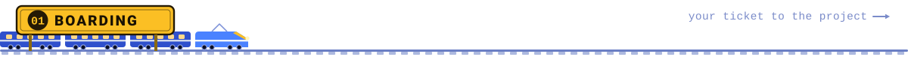

## Overview

**A desktop train-reservation system where the data structure is the star.**
Every booking, every waiting-list entry and every automatic seat promotion is powered by two hand-written, singly linked **FIFO queues** in plain C, wrapped in a GTK 3 dashboard that lets you watch them work in real time.

It models one train, the **Kerala Express (No. 12625)**, running **Thiruvananthapuram → New Delhi**, and was built as an open-ended Data Structures Laboratory project.

<div align="center">
<table>
  <tr>
    <td align="center" width="25%"><h3>38</h3><sub>CONFIRMED SEATS</sub></td>
    <td align="center" width="25%"><h3>4</h3><sub>CLASSES<br>SL · 3A · 2A · 1A</sub></td>
    <td align="center" width="25%"><h3>10</h3><sub>WAITING-LIST SLOTS</sub></td>
    <td align="center" width="25%"><h3>2</h3><sub>LINKED-LIST QUEUES</sub></td>
  </tr>
</table>
</div>

**Why a queue?** Ticket reservation is the textbook real-world FIFO: whoever has waited longest gets the next free seat. The twist this project adds is that promotion is *class-aware*, so a freed Sleeper seat goes to the first **Sleeper** passenger in line, never to someone waiting for AC.

| Class | Code | Seats |
| :--- | :---: | :---: |
| Sleeper | `SL` | 20 |
| AC 3-Tier | `3A` | 10 |
| AC 2-Tier | `2A` | 5 |
| AC First | `1A` | 3 |

### Run it in 60 seconds

```bash
sudo apt install -y build-essential pkg-config libgtk-3-dev   # once
make                                                           # compile
make run                                                       # launch the app
```

> [!TIP]
> New here? Skip to **[How it works](#how-it-works)**. Three short animations explain the whole system, and each one mirrors the real C code.

<br>


## Screens

An auto-playing tour of the four main screens. Pins appear on the features worth noticing.

<p align="center">
  
</p>

| Screen | What it does |
| :--- | :--- |
| **Dashboard** | Live confirmed / waiting / available / cancelled / auto-promoted counters, per-class availability bars, recent bookings and a live activity feed. |
| **Book Ticket** | Full booking form with validation, berth preference, and a live class-availability indicator that updates before you press confirm. |
| **Passengers** | Search by **PNR or Ticket ID**, filter by class and status, inspect a passenger, cancel from either queue. |
| **Activity Log** | A time-stamped audit trail of every booking, cancellation, promotion and reset, plus **New Journey** and **Reset System**. |

There is also a **Settings** page (Dark Mode, optional confirmation dialogs, train profile) and an **E-ticket** dialog after every booking with *Copy PNR* and *Save Ticket*.

<details>
<summary><b>Full-size screenshots</b> (click to expand)</summary>

<br>

<table>
  <tr>
    <td align="center"><a href="screenshots/01_dashboard.png">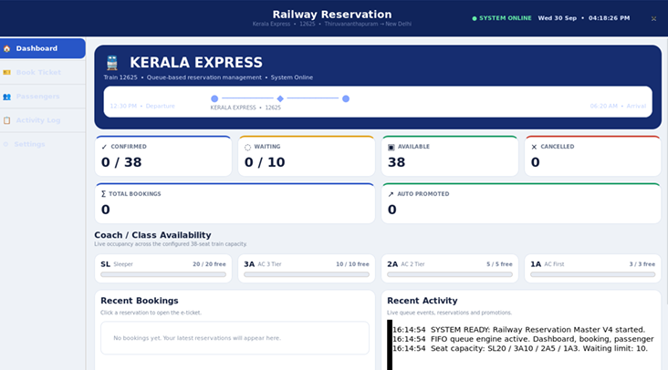</a><br><sub><b>Dashboard</b> · live statistics</sub></td>
    <td align="center"><a href="screenshots/02_booking_form.png">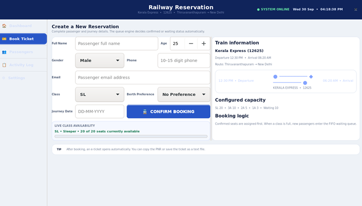</a><br><sub><b>Book Ticket</b> · validation + availability</sub></td>
  </tr>
  <tr>
    <td align="center"><a href="screenshots/03_passenger_management.png">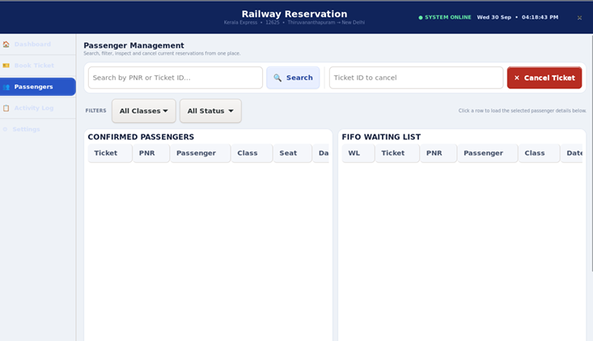</a><br><sub><b>Passengers</b> · search, filter, cancel</sub></td>
    <td align="center"><a href="screenshots/04_activity_log.png">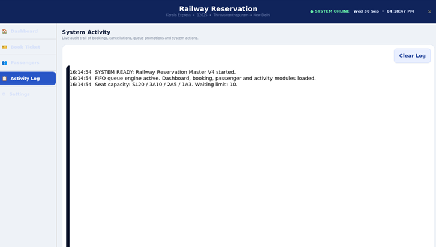</a><br><sub><b>Activity Log</b> · audit trail</sub></td>
  </tr>
</table>

</details>

<br>

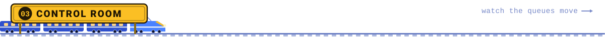

## How it works

Three loops, each about 15 seconds. Every box, pointer and log line in them comes straight from the C source (`on_book()`, `cancel_ticket_id()`, `make_seat()`), so what you see is what the program does.

### Booking: validate, check the class, enqueue at the rear

<p align="center">
  
</p>

1. **Validate.** Name is required, phone has 10-15 digits, the e-mail is well formed, and the date is a real `DD-MM-YYYY` calendar date.
2. **Check the class.** If the passenger's class still has a free seat (and the train has room), they are **confirmed** and given the lowest free seat number in that class.
3. **Otherwise they wait.** The passenger joins the **FIFO waiting list** with the next `WL` number. If the waiting list (10) is also full, the booking is rejected.
4. **Enqueue is O(1).** The new node is linked behind the old rear and the `rear` pointer moves, with no walking the list.

Each booking gets a sequential **Ticket ID** (from `1001`) and a unique 10-digit **PNR** (from `4817263951`).

### Cancellation: unlink, scan, promote

<p align="center">
  
</p>

1. **Unlink** the cancelled ticket from the confirmed queue (`remove_ticket`). The previous node's pointer simply hops over it.
2. **Scan** the waiting list from the front for the **first passenger of the same class** (`remove_first_class`). Ravi is ahead in line but wants `3A`, so he is skipped.
3. **Hand over the seat.** The freed seat number is copied onto the promoted passenger (Meera).
4. **Enqueue at the rear** of the confirmed queue. The waiting list closes up and the `WL` numbers are recomputed (Joseph moves from `WL3` to `WL2`).

The same events, as the app's *Activity Log* prints them:

```text
16:21:07  CANCELLED: #1032 | Rahul | Seat SL-03
16:21:07  PROMOTED: #1035 | Meera | SL | Seat SL-03
```

> [!NOTE]
> If nobody in the waiting list wants that class, the seat is simply released (`SEAT RELEASED: SL-03 is now available`) and the next booking for that class takes it. A cancelled *waiting* ticket just leaves the queue and everyone behind it moves up.

### Seat reuse: the lowest free number wins

<p align="center">
  
</p>

`make_seat()` builds a small `used[]` array from the confirmed queue and returns the first class seat that is still `0`. A cancelled seat leaves a gap; the next booking for that class fills it. **Two passengers can never share a seat.**

### The life of a ticket

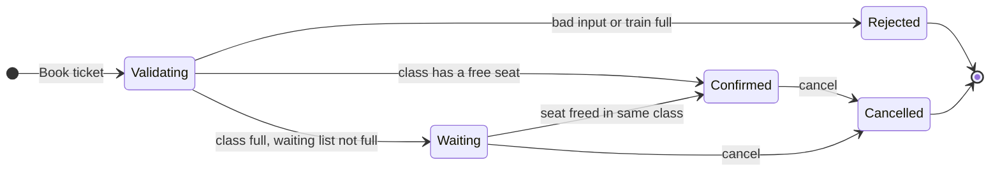

<br>

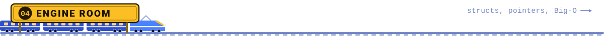

## Under the hood

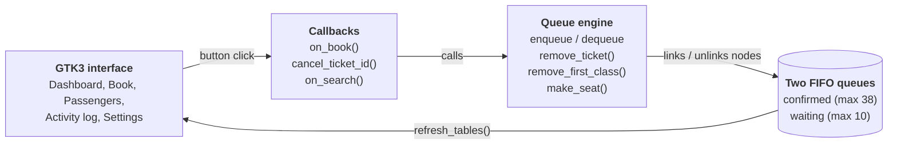

Everything lives in one self-contained source file, `src/railway_reservation_v4_responsive_no_top_bar.c` (about 2,700 lines). It needs only **GTK 3 and GLib**, with no other GUI toolkit or third-party library.

<details>
<summary><b>The passenger node</b> · <code>struct Passenger</code></summary>

```c
typedef struct Passenger {
    int  ticket_id;                 // Sequential ID starting from 1001
    char pnr[PNR_LEN];              // 10-digit unique PNR starting from 4817263951
    char name[NAME_LEN];            // Passenger name
    int  age;                       // Passenger age
    char gender[GENDER_LEN];        // Male, Female, Other
    char phone[PHONE_LEN];          // Contact phone number (10-15 digits)
    char email[EMAIL_LEN];          // Validated email address
    char travel_class[CLASS_LEN];   // SL, 3A, 2A, or 1A
    char from[FROM_LEN];            // Origin: Thiruvananthapuram
    char to[TO_LEN];                // Destination: New Delhi
    char date[DATE_LEN];            // Journey date (DD-MM-YYYY)
    char berth[BERTH_LEN];          // Berth preference
    char seat[SEAT_LEN];            // Allocated seat (e.g., SL-01, 3A-04)
    int  waiting_position;          // Current position in waiting queue
    struct Passenger *next;         // Pointer to next node
} Passenger;
```

</details>

<details>
<summary><b>The queue</b> · <code>Queue</code> and <code>enqueue()</code></summary>

```c
typedef struct {
    Passenger *front;               // Pointer to front node (dequeue / scan)
    Passenger *rear;                // Pointer to rear node (O(1) enqueue)
    int size;                       // Active count
} Queue;

static Queue confirmed;             // max 38 (MAX_CONFIRMED)
static Queue waiting;               // max 10 (MAX_WAITING)
```

```c
static void enqueue(Queue *q, Passenger *p)
{
    p->next = NULL;
    if (q->rear)
        q->rear->next = p;          // link behind the old rear
    else
        q->front = p;
    q->rear = p;                    // move the rear pointer
    q->size++;
}
```

</details>

<details>
<summary><b>Time complexity</b></summary>

<br>

| Operation | Time | Details |
| :--- | :---: | :--- |
| `enqueue(q, p)` | **O(1)** | Appends to rear via `rear->next` |
| `dequeue(q)` | **O(1)** | Removes from front via `front->next` |
| `remove_ticket(q, id)` | **O(n)** | Unlinks an arbitrary node with rear-pointer fix-up |
| `remove_first_class(q, class)` | **O(n)** | Finds the earliest waiting passenger of the matching class |
| `make_seat(...)` | **O(n + c)** | Gap search that reuses the lowest free seat number |
| `find_ticket(id)` / `find_pnr(pnr)` | **O(n)** | Linear lookup (n ≤ 48 records) |

</details>

<details>
<summary><b>Why linked lists?</b></summary>

<br>

- **Enqueue stays O(1)** because the queue keeps a `rear` pointer, so a booking never walks the list.
- **Cancellation and promotion happen mid-queue.** With linked nodes that is a pointer re-link, whereas an array would have to shift every element behind the gap.
- **Nothing is copied.** A promoted passenger is the *same* heap node, unlinked from `waiting` and linked into `confirmed`.
- **n is tiny** (at most 38 + 10 records), so the O(n) scans are effectively instant.

</details>

<details>
<summary><b>Scope and limits (by design)</b></summary>

<br>

- State lives in memory: closing the app clears the queues. Tickets can be saved as text files.
- One fixed train and route. Capacity is per train rather than per journey date.
- The 10-slot waiting list is shared across all classes.
- Berth preference is stored on the ticket but does not guarantee a real berth (the e-ticket says so too).

</details>

<br>

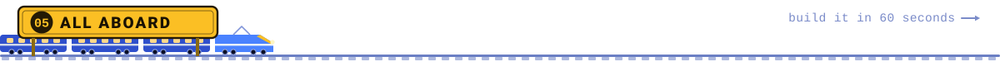

## Run it

**1. Install the prerequisites** (Ubuntu / Debian):

```bash
sudo apt update
sudo apt install -y build-essential pkg-config libgtk-3-dev
```

**2. Build:**

```bash
make
```

**3. Launch:**

```bash
make run
```

<details>
<summary><b>Other ways to build and run</b></summary>

<br>

| Task | Command |
| :--- | :--- |
| Build with the shell script | `bash scripts/build.sh` |
| Run with the shell script (builds first if needed) | `bash scripts/run.sh` |
| Remove the compiled binary | `make clean` |

Plain `gcc`, no Makefile:

```bash
gcc -Wall -Wextra -Wpedantic src/railway_reservation_v4_responsive_no_top_bar.c -o railway_v4 \
    $(pkg-config --cflags --libs gtk+-3.0)
./railway_v4
```

`make run` and `scripts/run.sh` start the app with a minimal, clean environment (`env -i`), so unrelated variables from your shell do not leak into GTK. The full command list is also in [`commands.txt`](commands.txt).

On other distributions, install the equivalent of GCC, `pkg-config` and the GTK 3 development headers (for example `gtk3-devel` on Fedora or `gtk3` on Arch).

</details>

<details>
<summary><b>Repository layout</b></summary>

<br>

```text
Railway_Reservation/
├── src/
│   └── railway_reservation_v4_responsive_no_top_bar.c   # the complete program
├── assets/                                              # animated SVGs used by this README
├── screenshots/                                         # real app screenshots
├── scripts/
│   ├── build.sh                                         # build script
│   └── run.sh                                           # clean-environment launcher
├── docs/
│   └── Railway_Reservation_System_Report.pdf            # full project report
├── commands.txt                                         # terminal commands, standalone
├── Makefile                                             # build / run / clean
└── README.md
```

</details>

📄 **Want the full write-up?** Read the [project report (PDF)](docs/Railway_Reservation_System_Report.pdf).

<br>

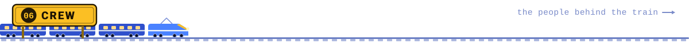

## Team

**Department of Computer Hardware Engineering**<br>
**Government Polytechnic College Palakkad** · *Academic Year 2026*

| Sl. No. | Student | Roll No. | Contribution |
| :---: | :--- | :---: | :--- |
| 1 | **ANIL VK** | 10 | **Queue Engine**: linked list, enqueue, dequeue, unlinking, FIFO promotion |
| 2 | **AMAN AP** | 8 | **Booking Module**: input validation, seat allocation, PNR and Ticket ID |
| 3 | **MIDHUN M** | 25 | **GTK3 Graphical Interface**: pages, widgets, styling, dark mode |
| 4 | **WILLIAM WILSON** | 36 | **Testing and Documentation**: testing, E-ticket generation, search / filtering, documentation |

<br>

<div align="center">

<sub>An educational simulation. It is not connected to Indian Railways or IRCTC and does not book real tickets.</sub>

<sub><a href="#top">Back to the top</a></sub>

</div>
